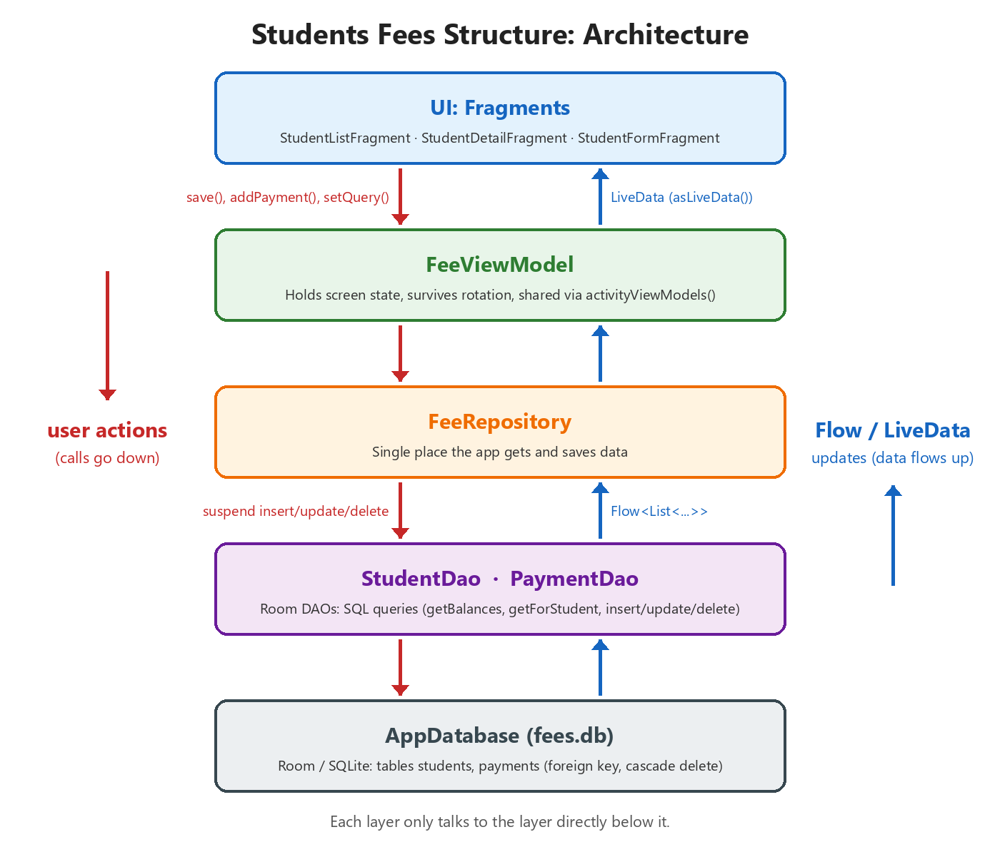

# Architecture and Data Flow



The app follows the MVVM pattern recommended by Android. It has one Activity and
three screens (Fragments) and is split into layers. Each layer only talks to the
layer directly below it.

```
Fragments (list, detail, form)
        │  user actions ↓        ↑ LiveData updates
FeeViewModel
        │                        ↑
FeeRepository
        │                        ↑ Flow
StudentDao / PaymentDao
        │                        ↑
AppDatabase (fees.db, Room / SQLite)
```

## What each layer does

| Layer | Files | Job |
|---|---|---|
| **UI (Fragments)** | `StudentListFragment`, `StudentDetailFragment`, `StudentFormFragment`, plus `MainActivity` that hosts them | Shows data and passes user actions (tap, type, save) to the ViewModel. Holds no database code. |
| **ViewModel** | `FeeViewModel` | Holds screen state (such as the search text) and exposes data as `LiveData`. Starts background work with `viewModelScope.launch`. |
| **Repository** | `FeeRepository` | The single place that decides where data comes from. Today it only calls the DAOs. |
| **DAOs** | `StudentDao`, `PaymentDao` in `Daos.kt` | The SQL queries. Room generates the code. |
| **Database** | `AppDatabase` | The Room database file `fees.db`, with tables `students` and `payments`. One shared instance for the whole app. |

## Tracing one data path: the student list

1. `StudentListFragment` observes `vm.students`.
2. `FeeViewModel.students` is `query.flatMapLatest { repo.balances(it) }.asLiveData()`.
   `query` holds the search text. Typing in the search box calls `vm.setQuery(...)`,
   which swaps in a new query.
3. `FeeRepository.balances(q)` calls `students.getBalances(q)`.
4. `StudentDao.getBalances(q)` runs one SQL query: it joins `students` with `payments`,
   sums each student's payments (`COALESCE(SUM(p.amount), 0) AS totalPaid`) and
   filters by name or admission number. It returns `Flow<List<StudentBalance>>`.
5. `StudentBalance.balance` is worked out as `feeCharged - totalPaid`.

Going the other way, when the user records a payment:
`StudentDetailFragment` → `vm.addPayment(p)` → `repo.addPayment(p)` → `PaymentDao.insert(p)`.
Room notices that the `payments` table changed and re-runs every Flow query that reads it,
so the list and detail screens update by themselves without any refresh code.

## Why is there a ViewModel?

When the phone rotates, Android destroys and recreates the Activity and Fragments.
The ViewModel is **not** destroyed, so the search text and loaded data survive the
rotation. It also keeps the fragments small: they only draw the screen.

## Why is there a Repository?

It is one place that decides where data comes from. If we later add an online API
or a cache, only the Repository changes. The ViewModel and screens stay the same.

## What are Flow and LiveData?

- **Flow** is a Kotlin stream of values over time. Room returns a `Flow` from each
  read query and sends a new list every time the table changes.
- **LiveData** is an Android holder that a screen can observe. It is lifecycle-aware:
  it only updates the screen while that screen is visible, and it stops by itself when
  the screen is destroyed, which avoids crashes and leaks.
- `asLiveData()` converts the Room `Flow` into `LiveData` so the Fragment can call
  `observe(viewLifecycleOwner) { ... }`.

## What does `activityViewModels()` do?

`private val vm: FeeViewModel by activityViewModels()` ties the ViewModel to the
Activity rather than to each Fragment. All three fragments therefore share **one**
`FeeViewModel`. A student saved on the form screen is already visible when the user
goes back to the list.

## Background threads

DAO write functions are `suspend` functions, started from `viewModelScope.launch`.
Room runs them on a background thread, so the screen never freezes while the database
works. `viewModelScope` cancels unfinished work when the ViewModel is cleared.

## Data persistence

- `Payment.studentId` is a **foreign key** to `Student.studentId` with
  `onDelete = CASCADE`: deleting a student also deletes their payments.
- `Student.admissionNo` has a **unique index**, so two students cannot share one admission number.
- `AppDatabase` is at version 2. `MIGRATION_1_2` adds the unique index without wiping
  existing data. The schema is exported to `app/schemas/`.

## Navigation

Navigation uses the Jetpack Navigation component (`res/navigation/nav_graph.xml`),
with `MainActivity` hosting a `NavHostFragment`. The toolbar's back arrow is wired with
`setupActionBarWithNavController`.

| From | Action | To | Argument |
|---|---|---|---|
| List (start) | tap a student | Detail | `studentId` |
| List | tap + button | Form (add) | `studentId = 0` |
| Detail | Edit | Form (edit) | `studentId` |
| Detail | Delete student (confirm) | back to List (`popBackStack`) | |
| Form | Save | back to previous screen (`popBackStack`) | |

The form uses `studentId == 0` to mean "add new" and any other value to mean "edit".

### Navigation test checklist

Run on an emulator and tick each:

- [ ] List → Detail → Edit form → Save returns to Detail with updated data
- [ ] List → Add form → Save returns to List with the new student
- [ ] Back button (system and toolbar arrow) works on every screen
- [ ] Rotate on every screen: no crash, data still shown
- [ ] Delete a student from Detail returns to List and the student is gone

### Issues found while reviewing the code

1. **Rotating the edit form loses unsaved changes.** In `StudentFormFragment`, the
   `loaded` flag resets when the screen is recreated, so after rotation the observer
   fills the fields again from the database and overwrites what the user typed.
   Suggested fix: only fill the fields when `savedInstanceState == null`.
2. **Save does not wait for the database.** `StudentFormFragment` calls `vm.save(...)`
   and then `popBackStack()` straight away, so a database error (such as a duplicate
   admission number) is not shown to the user. Benson's `trySave` task fixes this.

## Answers for the defence

- **Why not put database code in the fragment?** Fragments are destroyed on rotation
  and must not block the main thread. Keeping SQL in the DAO and logic in the ViewModel
  makes each part small, testable and reusable by every screen.
- **What happens to the data when the phone rotates?** The Fragment is rebuilt, but
  the ViewModel stays alive. The new Fragment observes the same LiveData and gets the
  latest list straight away. The database itself is never affected.
- **How does the list update by itself after a payment is added?** `getBalances` returns
  a Room `Flow`. Inserting a payment changes the `payments` table, Room re-runs the query
  and sends the new list, `asLiveData()` passes it on, and the Fragment's `observe` block
  redraws the list and totals.
